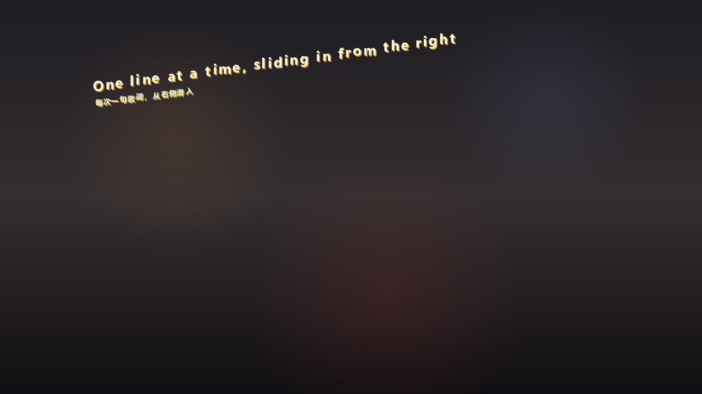
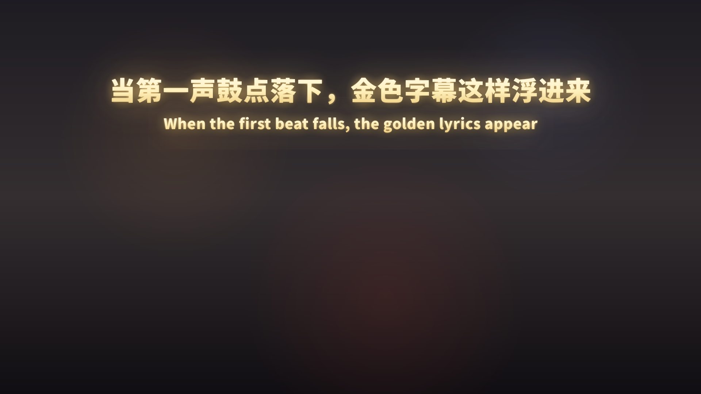

# 曲幕 Verseline · Windows 版

仿《边狱巴士》084 那套字幕的桌面歌词层。读网易云音乐或 QQ 音乐正在播放的歌曲，
把当前这句歌词画在桌面最上层——全屏透明、置顶、鼠标穿透，不用切回播放器就能跟着唱。


当前版本 **1.3.0**，免安装，解压即用。本版更换了全新产品图标，窗口、托盘与 exe 统一为
`ui_assets/verseline.ico`。

## 它做什么

- **自动跟随播放进度**：换句、暂停、拖动进度都能跟上，暂停时字幕自动隐藏。
- **两套字幕风格**：散落逐字、整句滑动，运行时热切换，字体字号各自独立保存。
- **双语字幕**：原文在上、官方译文在下。播放器没提供译文时只显示原文，不做机器翻译。
- **8 套配色**：原始金色、冷白极简、暮色紫、海盐蓝、薄荷青、樱花粉、落日杏、黑白映画；
  选中后还能逐项微调，随时一键恢复原配色。
- **不打扰操作**：无边框、置顶、鼠标穿透、不抢焦点、不占 Alt+Tab、任务栏无按钮。
- **常驻托盘**：关掉设置窗口字幕继续跑，托盘里管显示、换风格、校时间、退程序。

## 两种风格

| 散落逐字（默认） | 整句滑动 |
| --- | --- |
|  |  |

- **散落逐字**：每句丢到屏幕随机位置、随机倾斜 ±10°，字符按 0.1s 间隔逐个蹦出，每个字带
  轻微的随机抖动和金色落影。默认严格「一句一条」，新句出现时旧句直接换掉，不会堆成一坨。
- **整句滑动**：一屏一句，位置在屏幕上方约四分之一处，白到金的竖向渐变加泛光投影。
  换句时旧句向左滑出、新句从右侧滑入，长句超出屏幕直接裁切。

切换方式：托盘右键「切换渲染风格」，或者改 `config.json` 里的 `"style"`（`scatter` / `line`），
保存后自动生效。

## 快速开始

1. 下载本仓库（`Code → Download ZIP`）或 `git clone`，**完整解压**到桌面、文档这类普通文件夹。
2. 双击 `Verseline.exe`。第一次运行如果弹出「Windows 已保护你的电脑」，点「更多信息 → 仍要运行」。
3. 打开网易云音乐或 QQ 音乐放一首歌，字幕就出来了。
4. 想先看效果不放歌：`Verseline.exe --demo`。

不需要安装 Python。`_internal` 是内置运行环境，**必须和 exe 放在一起**，单独拷一个 exe 是跑不起来的。

> 不要放在 `Program Files` 这类受保护目录——配置和日志写在程序目录，会写不进去。

## 支持哪些播放器

| 播放器 | 读取方式 |
| --- | --- |
| 网易云音乐 3.x 桌面版 | 读客户端本地日志 `cloudmusic.elog`，拿到歌曲 ID、播放状态和进度 |
| QQ 音乐、酷狗等 | 走 Windows 系统媒体会话（SMTC），读曲目、进度和暂停状态 |

3.x 的网易云客户端不上报系统媒体会话，所以它单独走日志这条路；按歌曲 ID 直接取歌词，
不会匹配到翻唱。播放源可以设成「自动选择 / 网易云音乐 / QQ 音乐」，指定之后不会偷偷切到另一个。

## 界面

设置窗口分三个分类，左边是实时预览（就是真正跑在桌面上的那套渲染器，2 倍放大）：

- **外观与字幕**：风格、字体、字号、字重、字距、文字颜色、渐变、落影或泛光、不透明度、双语开关。
- **布局与动画**：散落模式的位置、行宽、同屏句数、倾斜、抖动、逐字速度；整句模式的垂直位置、
  滑动时长与距离、泛光。
- **播放与同步**：整体时间偏移、音乐来源、暂停隐藏、启动行为、诊断日志。

改完约 0.16 秒自动写入 `config.json`，没有「保存」按钮。预览下方的「字幕配色」下拉框里
是 8 套预设；「恢复原配色」只还原颜色，不动字体、字号、双语、描边和时间校准。

## 托盘菜单

| 菜单项 | 作用 |
| --- | --- |
| 打开字幕工作台 | 显示并激活设置窗口 |
| 显示 / 隐藏字幕 | 只切字幕显示状态，不暂停音乐 |
| 切换渲染风格 | 在散落逐字与整句滑动之间切换，并写回配置 |
| 时间校准 | 字幕提前 / 延后 0.2s |
| 重新加载歌词 | 按当前歌曲重新拉一次歌词 |
| 打开配置文件 / 打开日志 | 直接打开 `config.json` 和 `overlay.log` |
| 退出 | 结束程序 |

## 命令行参数

| 参数 | 说明 |
| --- | --- |
| `--background` | 后台启动，只留托盘，不弹设置窗口 |
| `--preview [歌曲ID]` | 不放歌，用真实歌词按 1 倍速合成时钟预览 |
| `--demo` | 示例句子循环播放，不需要播放器和网络 |
| `--snapshot 目录` | 按当前配置把预览图渲染到指定目录后退出 |
| `--dump` | 打印当前检测到的会话、选中项和歌词匹配结果 |
| `--match 标题 [歌手]` | 查一下这首歌能不能匹配到歌词 |
| `--config 路径` | 指定配置文件，方便同时留几套配置 |
| `--self-check 报告` | 自检内置运行时、Qt 插件、字体和绘制，输出报告 |

## 字幕跟歌声对不上

播放器上报的进度、音频输出延迟和人的听感之间天然有几十到几百毫秒的差距。
托盘右键「时间校准」里有「字幕提前 0.2s / 字幕延后 0.2s」，点几下到自己听着舒服为止，
数值会写回 `config.json` 的 `offset_sec`（正数=字幕更早出现）。

整首歌稳定地快或慢一个固定值，说明是播放器上报的固定偏差，校准一次就够了；
如果只有某几句偏，多半是歌词文件本身的时间轴问题。

## 常见问题

**放歌了但没有字幕**
先看界面「当前播放」区域有没有识别到歌曲。没有的话运行 `Verseline.exe --dump`，
看 `sessions` 里有没有会话、`status` 是不是 `Playing`。纯音乐、播客、无版权歌曲没有官方歌词，
句数显示 0 是正常的。也可以双击 `启动诊断.cmd` 生成一份环境报告。

**字看起来糊、笔画粘在一起**
别用可变字体（比如 `Noto Sans SC`）配超粗字重，Qt5 对这种组合的轮廓实例化会出错。
散落模式换成微软雅黑，整句模式用思源黑体 Heavy 这类静态字重。

**全屏游戏里看不到字幕**
独占全屏会接管显示输出，任何桌面悬浮窗都盖不上去。把游戏改成「无边框窗口」或「窗口化全屏」。

**改动设置没保存**
配置写在程序目录，放在 `Program Files` 等受保护位置会写失败。把整个文件夹挪到桌面或文档。

**双击没反应**
这是单实例程序，第二次启动会唤起已经开着的窗口而不是再开一套。如果既没窗口也没字幕，
看看托盘图标在不在、进程有没有起来。

## 目录结构

```
Verseline.exe               入口（原生启动器）
_internal/                  内置 Python / Qt / 依赖，必须与 exe 同目录
ui_assets/                  图标资源
docs/licenses/              第三方许可证原文
docs/preview/               界面截图
config.json                 个人配置（首次启动自动生成）
color_presets.json          8 套配色预设（除原始金色外的 7 套可编辑）
package-manifest.json       发行包文件清单
使用说明.txt                 简短上手说明
启动诊断.cmd / 诊断启动.ps1   启动诊断，出问题时生成报告
```

## 运行环境

| 项 | 要求 |
| --- | --- |
| 系统 | Windows 10 / 11，64 位 |
| 处理器 | x64 双核及以上 |
| 内存 | 4 GB（推荐 8 GB） |
| 显示 | 1280×720 及以上，支持 100%～200% 缩放 |
| 硬盘 | 约 120 MB |
| 依赖 | 无需安装 Python 或运行库 |
| 网络 | 仅用于向播放器官方接口取歌词 |

## 已知限制

- 只在主显示器上显示，多屏没有做选择。
- 独占全屏的游戏会遮住悬浮窗。
- QQ 音乐走系统媒体会话，客户端版本必须提供 SMTC；部分精简版不提供就读不到进度。
- 网易云客户端的面板做了多进程 CEF 渲染，抓不到文本层，所以亚秒级对齐只能靠手动校准。

## 许可与致谢

- 本仓库的程序部分按 [Apache-2.0](LICENSE) 发布。
- 运行时包含 PyQt5 / Qt5（Riverbank Computing，GPL v3 或商业授权）以及其他第三方组件，
  许可证原文见 `docs/licenses/` 与 [THIRD_PARTY_NOTICES.md](THIRD_PARTY_NOTICES.md)。
- 散落逐字的算法思路（随机位置与倾斜、逐字、抖动、金色落影）和从 `elog` 取歌曲 ID 的做法
  参考了 [LKornway/LimbuslikeLrc](https://github.com/LKornway/LimbuslikeLrc)（MIT），
  本项目为独立实现，没有复制其代码。
- 歌词来自网易云音乐、QQ 音乐的官方接口，只在本机显示，不写入磁盘。请支持正版。
